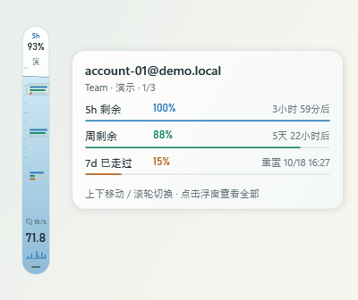
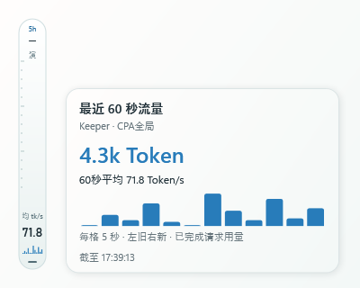
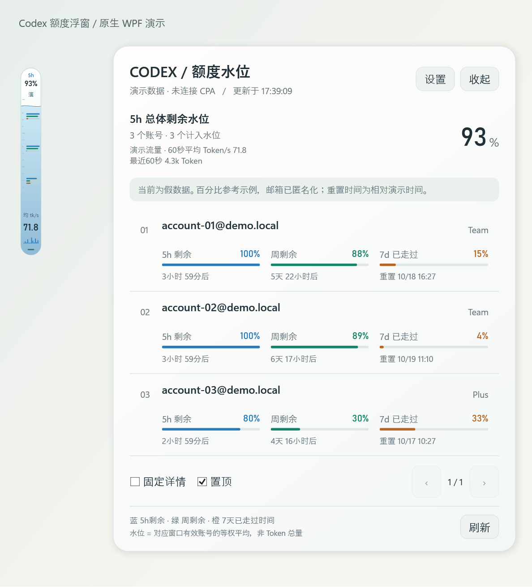
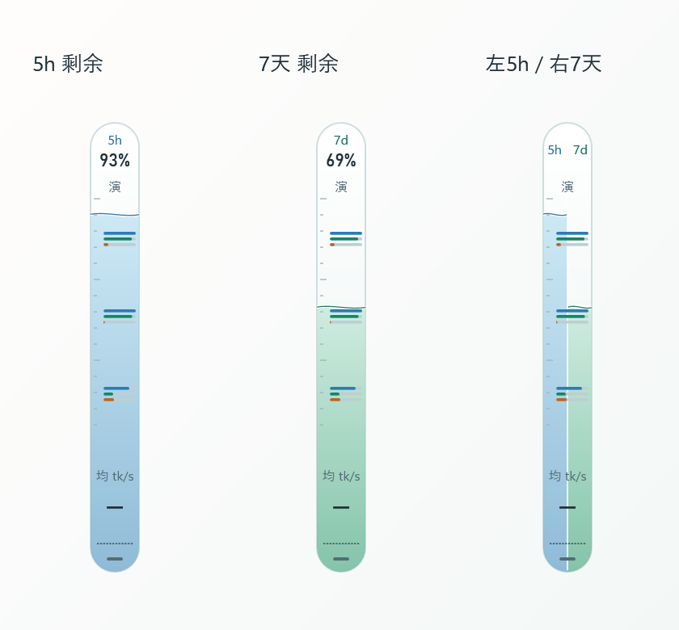
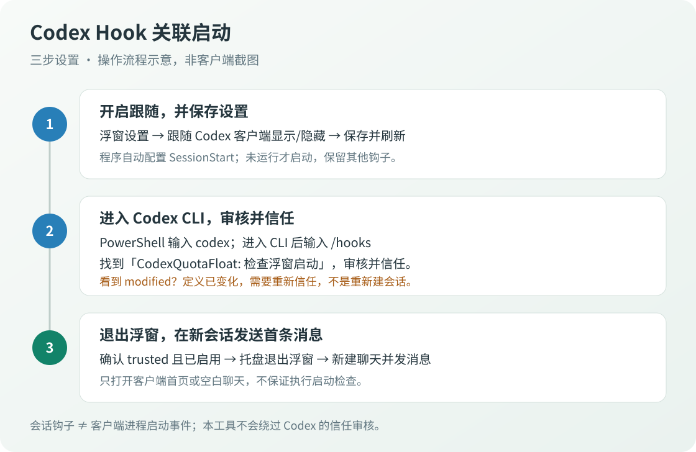

# CodexQuotaFloat · Codex 额度水位

Windows 原生桌面浮窗：用水位查看多个账号的 Codex 剩余额度，悬停查看详情，保持低干扰。

支持 **CPA 管理额度 / 本地 Codex 认证**，可接入 **CPA Usage Keeper** 查看最近 Token 流量。首次使用演示数据，不自动连接服务。

## 界面预览

以下均为程序离线渲染的**匿名演示数据**，不是实际账号截图。

| 水柱与单账号详情 | 最近60秒 Token 流量 |
| --- | --- |
|  |  |



单栏保留百分比；双栏顶部以左 **5h**、右 **7d** 区分，悬停查看总体百分比。



## 下载与启动

从 [GitHub Releases](https://github.com/wangshuai-007/CodexQuotaFloat/releases) 下载 Windows x64 发布包：

| 产物 | 适用情况 |
| --- | --- |
| `CodexQuotaFloat-版本-win-x64-self-contained.zip` | **推荐**。包含 .NET 10 Desktop 运行时，无需另装 .NET |
| `CodexQuotaFloat-版本-win-x64-framework-dependent.zip` | 轻量版，需要 [.NET 10 Desktop Runtime x64](https://dotnet.microsoft.com/en-us/download/dotnet/10.0) |
| `SHA256SUMS.txt` | 两个发布包的 SHA256 校验值 |

要求 Windows 10/11 x64。完整解压后双击 `CodexQuotaFloat.exe`，不要只复制EXE。首次显示演示额度，右键水柱或托盘进入设置切换真实来源。更新前从托盘退出旧程序，用完整新包替换程序目录；设置保存在程序目录之外。

发布包未数字签名，Windows可能提示未知发布者。请核对来源和校验值，不要全局关闭安全保护。自包含包的运行时随应用版本更新，不依赖系统升级，建议使用最新发布包。[微软自包含发布说明](https://learn.microsoft.com/en-us/dotnet/core/deploying/)

## 功能与操作

- **额度水位**：5小时、7天或左右双水位，按各窗口有效账号等权平均计算。
- **三色账号线**：蓝色5h剩余、绿色周剩余、橙色固定7天周期已走过的时间。
- **悬停逐账号详情**：上下移动查看对应账号；滚轮切换，同屏最多10组线，更多账号可滚动。
- **点击全部列表**：分页及短屏滚动；账号行悬停显示置顶、最后及拖动排序，只改变本地顺序。
- **桌面浮窗**：48×296逻辑像素，支持边缘停靠、置顶、多显示器及不同缩放。
- **跟随 Codex**：附着客户端，最小化或完整覆盖时隐藏；拖动水柱保存相对窗口位置，独立位置单独保留。
- **最近 Token 流量**：每秒独立查询；悬停显示最近60秒总量和12格趋势，不展示请求次数。

| 操作 | 行为 |
| --- | --- |
| 悬停 / 上下移动 | 逐账号详情；顶部总体额度，底部流量 |
| 滚轮 / ↑ ↓ | 切换账号及滚动视口 |
| 点击 / Enter / Space | 展开或收起全部账号列表 |
| 拖动水柱 | 独立模式可屏幕边缘吸附；附着模式保存相对位置 |
| Escape | 收起详情 |
| F5 | 刷新，修正认证后重试 |
| Ctrl+, | 设置 |
| 托盘双击 | 显示浮窗，不清除跟随选项 |
| 账号行 Alt+↑ / ↓ | 本地逐行排序 |

跟随默认关闭，仅识别桌面客户端，不跟随网页或CLI控制台。附着时主浮窗和全部列表不做全局置顶；鼠标悬停的账号、总体额度和流量提示卡始终置顶且不抢焦点，移出后按原延迟收起。独立模式的置顶偏好保留；找不到客户端或无法附着时自动独立显示，之后继续尝试附着。不控制、移动或最小化Codex，不建立跨进程Owner。

### Codex Hook 关联启动

开启跟随后，程序自动配置用户级 `SessionStart` 启动检查：**未运行则后台启动，已运行则静默跳过**。关闭跟随只移除本工具的钩子，保留其他配置。



1. 浮窗设置中勾选 **跟随 Codex 客户端显示/隐藏**，保存。
2. 在 PowerShell 输入 `codex`；进入 CLI 后输入 `/hooks`，审核并信任 **CodexQuotaFloat: 检查浮窗启动**。
3. 退出浮窗，在 Codex **新建聊天并发送首条消息**，验证自动启动。

设置页会显示当前钩子的信任与启用状态，支持 **重新检测**；保存后再次检测并提示。未信任、已修改、禁用或查询失败时不会误报“已就绪”，也不会自动授予信任。

**这不是客户端进程启动事件。** 本机引擎实测首次发送消息后执行钩子，仅打开客户端或空白聊天不保证触发，也不是每条消息都会检查。首次添加、更新命令或移动程序目录后需审核信任；`modified` / `untrusted` 状态不会因新建会话而自动变成可信。

图中是流程示意，不是客户端截图。配置位置、更新迁移、关闭方式和排错见 [Hook 关联启动图文指南](docs/codex-hook.md)。

## 连接数据源

### CPA 多账号额度

设置 → 数据源 → **CPA 管理额度**，填写完整管理地址和管理密钥：

- 新版默认 `http://127.0.0.1:8317/v8/management`；旧版分支可显式填写 `/v0/management`，不静默回退。
- 远程必须HTTPS，本机回环可HTTP。只查询启用的Codex账号，不重置、不修改账号、不下载凭据。
- 密钥只保留当前会话，也可配置 `CPA_MANAGEMENT_KEY`，按进程→Windows用户→系统环境变量读取。
- 额度同步 **5–3600秒**，默认60秒；未完成的上一轮查询不重叠。

不同CPA版本接口可能不同，详细配置和排错见 [数据源配置](docs/configuration.md)。

### 本地 Codex 额度

设置 → 数据源 → **本地 Codex 认证（ChatGPT登录）**。路径留空优先复用原生Codex CLI当前登录（文件或keyring认证）；无CLI时尝试默认auth.json。也可手动选择认证文件只读查询。

只显示当前账号，不与CPA混合。API Key登录没有订阅额度。本工具不复制或保存OAuth令牌、不创建推理请求；CLI自行维护认证缓存。文件直连使用内部额度接口，可能受上游更新影响，优先使用CLI方式。

### CPA Usage Keeper 流量

勾选 **使用 CPA Usage Keeper 查询Token统计**，填写独立部署的 [CPA Usage Keeper](https://github.com/Willxup/cpa-usage-keeper) **应用根地址**和其登录密码。

例如 `https://stats.example.com/` 或 `https://stats.example.com/keeper/`。它不是CPA管理地址或Keeper插件菜单地址；只安装插件不等于已部署Keeper服务。

Keeper与额度来源独立，可搭配CPA或本地额度。密码仅会话保存，也可由 `KEEPER_LOGIN_PASSWORD` 提供。可信局域网HTTP需明确允许，密码和会话可能明文传输。浮窗每秒只读查询Keeper事件，**不消费CPA队列**。兼容旧版CPA用量接口及同源自定义快照，见 [数据源配置](docs/configuration.md)。

## 指标口径与安全

- 水位是有效账号**剩余百分比的等权平均**，不是Token绝对总额度。失败、缺失或到期窗口不参与平均，无有效数据显示“—”。
- 橙色线：`clamp(1 - (周重置时间 - 当前时间) / 7天, 0, 1)`，表示时间进度，不是已用额度。
- **均 tk/s = 最近60秒已完成请求Token总量 ÷ 60秒**，不是正在生成的输出速度。长请求完成前、Keeper采集延迟和服务缓存会影响显示。
- 流量按CPA/Keeper全局口径统计，不一定只来自列表账号。无完成记录显示“—”并说明；错误或过期不沿用旧速率。
- 本地认证仅提供额度，需要独立Keeper或统计来源才能展示流量。
- 不跳过TLS验证、不跟随HTTP重定向，不跨源转发CPA管理密钥。

## 构建与发布

需要Windows及 [.NET 10 SDK](https://dotnet.microsoft.com/en-us/download/dotnet/10.0)，建议PowerShell 7。在仓库根目录执行：

```powershell
dotnet run --project "tests/QuotaFloat.Tests/QuotaFloat.Tests.csproj" -c Release
& "scripts/build-local.ps1"
& "release/CodexQuotaFloat.exe" --demo
& "scripts/publish-release.ps1" -Version "0.1.0"
```

普通Build后完整输出自动复制到 `release/`。本地构建脚本只结束本项目占用文件的测试程序，构建与哈希校验成功后重启；失败不启动不完整版本。发布打包用独立暂存目录，不覆盖本地测试程序。

生成两个ZIP、SHA256及发布说明，位于 `artifacts/github-release/0.1.0/`。自包含发布不裁剪WPF运行时，不是单文件EXE。标签推送触发GitHub Release草稿，手动运行仅生成Actions产物，详见 [发布流程](docs/publishing.md)。

## 测试与截图

```powershell
& "release/CodexQuotaFloat.exe" --render-preview "artifacts"
Start-Process -FilePath "release/CodexQuotaFloat.exe" -ArgumentList '--smoke-test "artifacts/native"' -WindowStyle Hidden -Wait
& "scripts/update-screenshots.ps1"
```

离线预览不读取用户设置、不连接CPA，截图仅用匿名数据。原生冒烟创建实际窗口，不操作系统鼠标或保存配置；检查日志保存在指定输出目录。自动检查不替代真实认证联调和物理鼠标验收；CI执行逻辑及离线WPF检查，多屏原生检查需本地交互式桌面。

设置位于 `%LOCALAPPDATA%/CodexQuotaFloat/settings.json`，含界面选项、服务地址、可选认证路径和排序账号ID，不含密码、OAuth令牌或额度快照。分享日志前检查账号标识、地址和本机路径，不提交auth.json、.env或真实配置。

本项目不是OpenAI官方产品，与CPA和Keeper独立维护。
