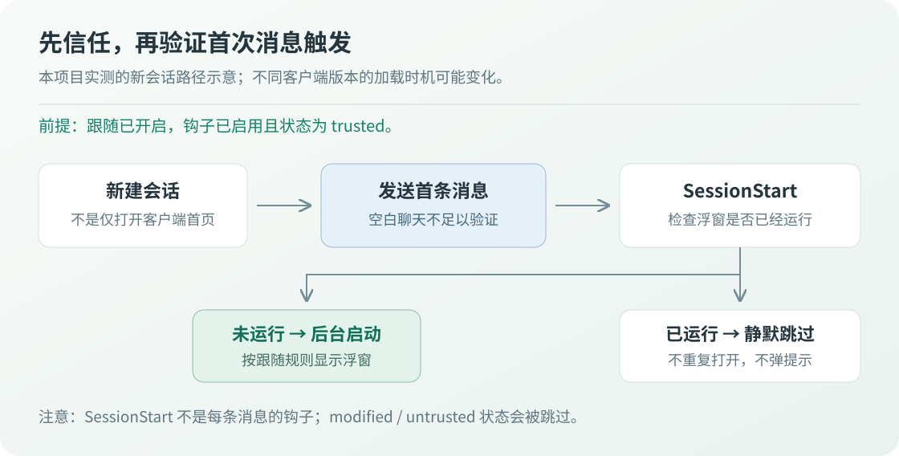

# Codex Hook 关联启动

开启“跟随 Codex 客户端显示/隐藏”后，浮窗会自动配置 `SessionStart` 钩子。**会话开始时检查浮窗：未运行则后台启动，已运行则静默跳过。** 无需手动复制钩子命令。

它不是 Windows 开机启动，也不是 Codex 客户端进程的启动事件。仅打开客户端或空白聊天，不保证立即出现浮窗。

## 三步设置


上图为操作流程示意，不是 Codex 客户端或 CLI 的界面截图。

### 1. 在浮窗中开启跟随

首次先手动运行解压目录中的 `CodexQuotaFloat.exe`，从浮窗右键菜单或托盘进入设置：

- 勾选 **跟随 Codex 客户端显示/隐藏**，点击 **保存并刷新**。
- 也可直接使用浮窗右键菜单中的 **跟随 Codex 显示/隐藏**。
- 程序添加自身的启动检查，不覆盖其他钩子；配置失败时会明确提示。

勾选后，下方会只读检测当前用户配置中的钩子状态；打开已开启跟随的设置页也会检测。点击 **重新检测** 可更新结果，不会自动信任。勾选但尚未保存时检测的是已有配置，保存后程序会再次检测并提示结果。

| 页面状态 | 含义 |
| --- | --- |
| 已信任、已启用 | 当前启动命令的关联启动已就绪，不代表会话已经触发 |
| 尚未信任 / 已修改 | 需要在 Codex 中审核，或重新审核信任 |
| 已禁用 / hooks功能关闭 | 需要启用钩子，或检查用户及管理员配置 |
| 尚未检测到 / 命令不一致 | 保存跟随设置以配置当前程序，再审核信任 |
| 无法读取 / 检测超时 | 状态未知，不会误报就绪；可重新检测或手动检查 |

检测使用本机原生 Codex CLI 的只读接口，最多等待约8秒，不创建聊天或推理请求。CLI与桌面客户端使用不同 `CODEX_HOME` 或不同版本时，结论可能不同，应同时在实际使用的客户端核对。

### 2. 在 Codex 中审核并信任钩子

在 PowerShell 中输入以下命令，进入 Codex CLI：

```powershell
codex
```

**进入 Codex CLI 后**再输入 `/hooks`，不要把它当作 PowerShell 命令。找到状态说明为 **`CodexQuotaFloat: 检查浮窗启动`** 的 `SessionStart` 钩子，审核启动命令及程序位置，再执行信任操作。

| 信任状态 | 含义 | 操作 |
| --- | --- | --- |
| `untrusted` | 新增钩子尚未信任 | 审核并信任 |
| `modified` | 当前定义与上次信任的内容不同 | 重新审核并信任 |
| `trusted` | 当前定义已经信任 | 同时确认钩子处于启用状态 |

**更新启动命令、迁移程序目录后，可能需要重新信任。** 仅新建会话或重启客户端，不会自动把 `modified` 变成 `trusted`。程序不会修改信任记录，也不绕过审核。[OpenAI 官方钩子说明](https://learn.chatgpt.com/docs/hooks#review-and-trust-hooks)

### 3. 发送首条消息验证

1. 确认钩子已启用且状态为 `trusted`。
2. 从托盘选择 **退出**，完全退出浮窗，而不是只收起账号详情。
3. 在 Codex 新建一个聊天，并发送第一条正常任务消息。
4. 检查浮窗是否自动启动。触发后，重复检查不会重复打开窗口或弹出“已在运行”。

本项目在本机 Codex CLI `0.163.0-alpha.10.2` 的引擎验证中，**仅创建会话未观察到钩子执行，发送首次消息后观察到了 `SessionStart`**。不同客户端版本的加载时机可能变化；验证时应完成首次消息发送，而不是仅打开空白聊天。

## 什么时候会启动？



上图为本项目实测的新会话验证路径，不表示每条消息都会触发 `SessionStart`。

- **新会话首次发送消息**：按上述步骤验证启动检查。
- **恢复旧会话**：Codex 重新加载会话时可能触发；仅切换侧边栏聊天不保证重新加载。
- **同一会话继续聊天**：不是每条消息都检查；退出浮窗后继续原会话，不保证重新启动。
- **只打开客户端首页**：不保证触发。这套功能不能保证客户端窗口刚出现时就启动浮窗。
- **CLI 使用相同用户配置**：也可能触发启动检查，但窗口附着仍只跟随桌面客户端，不跟随 CLI 控制台。

## 没看到浮窗时怎么排查？

| 情况 | 检查方法 |
| --- | --- |
| 新建聊天后没出现 | 先发送首条消息；仅创建空白会话不足以验证 |
| 状态仍是 `modified` / `untrusted` | 在 CLI 的 `/hooks` 中审核并信任当前定义 |
| `/hooks` 找不到本工具 | 确认已保存跟随设置，且浮窗与 Codex 使用同一份 `CODEX_HOME` |
| 钩子可信但没有执行 | 检查是否被禁用，以及用户或管理员配置是否关闭了 hooks |
| 已运行但看不到 | 查看托盘；跟随模式可能因客户端最小化、隐藏或被完整覆盖而隐藏。返回 Codex，或使用托盘“显示浮窗” |
| 程序目录移动或发布包被删除 | 在新位置完整解压并手动启动一次，更新启动路径后重新审核信任 |
| 设置提示配置失败 | 检查 `hooks.json` 的 JSON 格式及目录写入权限；不要覆盖整个文件或删除其他钩子 |

## 配置与关闭方式

用户级文件位于 `CODEX_HOME/hooks.json`；未设置 `CODEX_HOME` 时，默认是 `%USERPROFILE%/.codex/hooks.json`。程序修改前保留 `hooks.json.CodexQuotaFloat.*.bak` 备份，只维护自身标记的 `SessionStart` 处理器。

关闭“跟随 Codex”并保存，会移除本工具的启动检查，保留其他钩子。**退出浮窗不会移除钩子**，否则下次会话无法关联启动。关闭跟随后，已加载旧定义的会话即使发起迟到检查，浮窗也会静默退出。

本功能仅启动本机浮窗，不上传账号数据；CPA、Keeper 或本地认证的查询方式保持不变。不要在问题报告中附带管理密钥、认证文件或整份真实配置。

[返回 README](../README.md) · [数据源配置](configuration.md)
